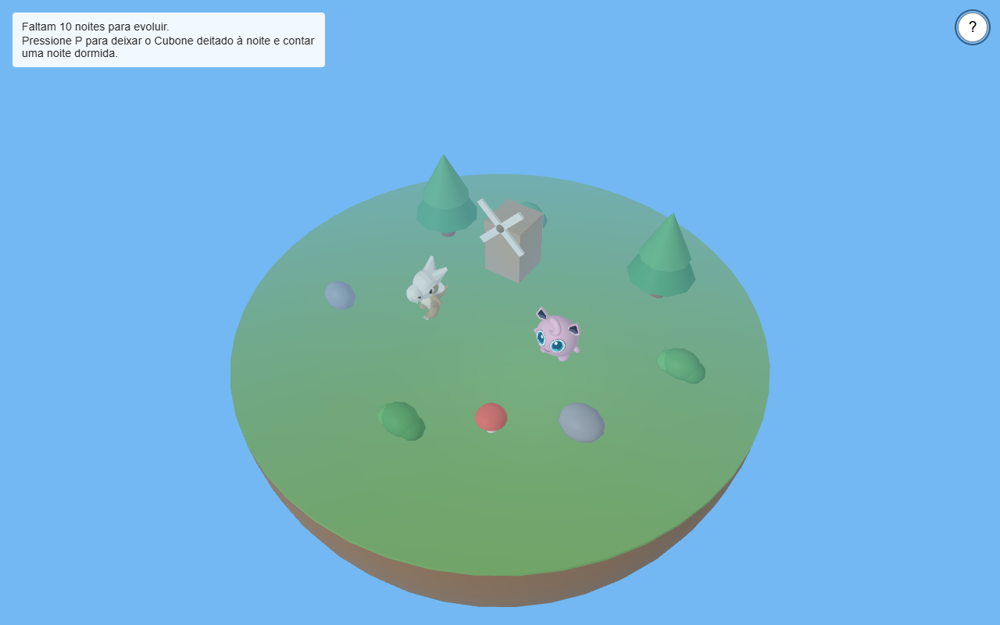
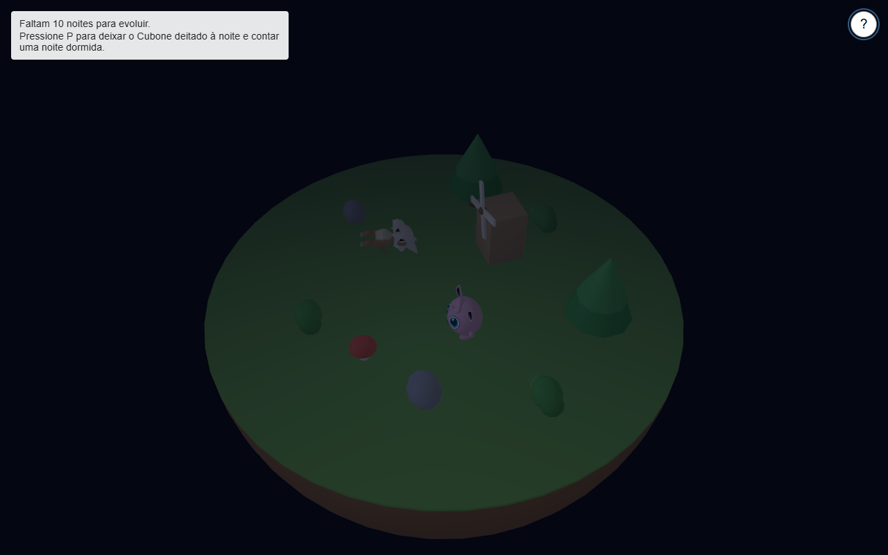

# Paraíso Pokémon

## A Cena

Uma ilha 3D para o Cubone e o Jigglypuff, feita para o [TP2 de Computação Gráfica](https://github.com/fegemo/ufci-cg/blob/main/assignments/tp2-paradise/README.md). O Cubone passeia pela ilha e chora à noite. Depois de dormir durante 10 noites, ele evolui para Marowak de Alola. A cena também tem uma mensagem para a Amora.

**Controles**

| Comando | O que faz |
| --- | --- |
| WASD | Move o Jigglypuff |
| P | Alterna o Cubone entre descansar e passear; ele fica sentado de dia e deitado à noite |
| 1 | Câmera automática em volta da ilha |
| 2 | Câmera orbital, controlada ao arrastar o mouse |
| 3 | Câmera que acompanha o Jigglypuff |
| Scroll do mouse | Aproxima ou afasta a câmera |
| L | Liga ou desliga a iluminação |
| N | Liga ou desliga a neblina |
| ? | Abre os comandos e as configurações |

Para contar uma noite dormida, deixe o Cubone deitado durante a noite. No menu `?`, também dá para ajustar a duração do dia e da noite e controlar a música e os efeitos sonoros.

**Como rodar**

Abra a pasta com o Live Server do VS Code ou rode este comando na raiz, se tiver Python instalado:

```sh
python -m http.server 8000
```

Depois acesse `http://localhost:8000` em um navegador com WebGL2. O jogo usa JavaScript, WebGL2 e TWGL.js; o servidor local é necessário para carregar os módulos, shaders e modelos.

## Criador

- **Nome:** Heitor Augusto Botelho.
- **Contato:** heitorhab123@gmail.com.

## Media kit





## Opcionais

Os nomes seguem os tópicos do enunciado. Aqui está o que entrou no jogo:

- **Modelos tridimensionais:** Cubone, Marowak de Alola e Jigglypuff são carregados como modelos GLB.
- **Movimentação autônoma:** o Cubone alterna entre ficar parado e passear, escolhendo destinos na ilha e desviando dos objetos.
- **Ciclo dia/noite:** as cores do céu e da iluminação mudam conforme o tempo passa; a duração dos períodos pode ser ajustada no menu.
- **Neblina:** pode ser ligada ou desligada durante o jogo com a tecla `N`.
- **Música, efeitos sonoros e/ou som ambiente:** há música de fundo, choro do Cubone à noite, passos e uma fanfarra na evolução.

## Créditos

- **Proposta:** [TP2 — Paraíso Pokémon, de fegemo/ufci-cg](https://github.com/fegemo/ufci-cg/blob/main/assignments/tp2-paradise/README.md).
- **Tema:** Pokémon e seus personagens, da Nintendo, Game Freak e The Pokémon Company.
- **Sprites:** Cubone e Marowak de Pokémon Ruby e Sapphire, disponíveis no [repositório de sprites da PokéAPI](https://github.com/PokeAPI/sprites/tree/master/sprites/pokemon/versions/generation-iii/ruby-sapphire).
- **Choro do Cubone:** [PokéAPI — Pokémon cries](https://github.com/PokeAPI/cries).
- **Música de fundo:** Route 101, de Pokémon Sapphire, disponível no [Zophar's Domain](https://www.zophar.net/music/gameboy-advance-gsf/pokemon-sapphire).
- **Fanfarra de evolução:** Pokémon Ruby & Sapphire, disponível no [KHInsider](https://downloads.khinsider.com/game-soundtracks/album/pokemon-ruby-sapphire-music-super-complete).
- **Ferramentas:** [TWGL.js](https://twgljs.org/), JavaScript, WebGL2 e [Blender](https://www.blender.org/).
